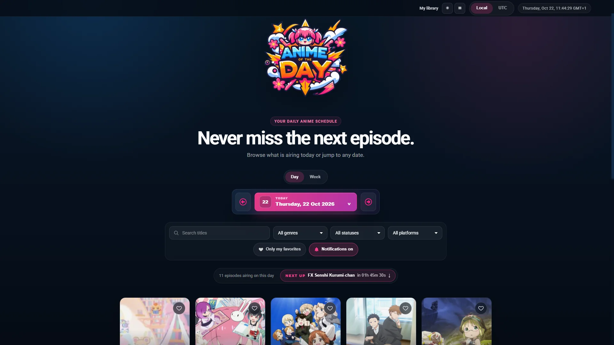

# AOTD :: Anime of the Day

Web calendar of anime releases. The app queries the AniList GraphQL API, lists the episodes scheduled for each day and shows details about every title.



## Features

- Daily schedule with infinite scroll and a weekly view (seven columns)
- Local time or UTC, picked in the top bar
- Countdowns calculated from `airingAt`
- "Next up" button that jumps to the next episode of the day
- Search by title and filters by genre, status, platform and "only my favorites", kept in the URL
- Favorites stored in the browser and synced across tabs
- "My library" page with favorites, upcoming episodes and recently viewed titles
- `.ics` file to add episodes to a calendar
- Native sharing (or copying the link) on the details page
- Shortcuts: ← and → change the day (or week), T goes back to today
- Installable PWA, with the app shell available offline
- Release notifications through Web Push, even with the site closed
- Saved data shown with a notice when AniList cannot be reached
- Cookie banner: Google Analytics only loads after it is accepted
- Roboto font served by the site itself, with no requests to Google Fonts
- Error monitoring with Sentry (optional)

## Requirements

- Node.js 22.22 or newer (the test tools need it; the build alone runs on 20.19 or newer)
- npm 10 or newer

## Development

```bash
npm run install:all
npm run dev
```

`install:all` installs the dependencies of the frontend and of the push server (`server/`), which has its own `package.json`. A plain `npm install` in the root does not install `server/node_modules`, and the server tests fail without `web-push`.

By default the dev server opens on `http://localhost:7115`. Copy `.env.example` to `.env` to change the port or set up Sentry.

| Variable           | Purpose                                               |
| ------------------ | ----------------------------------------------------- |
| `PORT`             | Port of the development server                        |
| `VITE_SENTRY_DSN`  | Sentry DSN; empty turns monitoring off                |
| `PUSH_SERVER_PORT` | Port of the local push server, used by the Vite proxy |

### Push notifications in development

```bash
npm --prefix server run setup-env   # once: creates server/.env with the VAPID keys
npm run dev:push                    # in another terminal, next to npm run dev
```

`dev:push` listens on `PUSH_SERVER_PORT` (3100 by default), accepts requests from `http://localhost:PORT` and stores its data in `server/data-dev`, apart from production data. There is no need to edit `server/.env`.

## Commands

- `npm run dev`: development server.
- `npm run dev:push`: local push server for `npm run dev`.
- `npm run build`: production bundle in `dist/`.
- `npm run preview`: serves the production bundle.
- `npm test` / `npm run test:watch`: unit tests (Vitest).
- `npm run test:e2e`: end to end tests (Playwright). The first time, run `npx playwright install chromium`.
- `npm run test:server`: push server tests (requires `npm run install:all`).
- `npm run test:all`: frontend and server tests.
- `npm run check`: lint, typecheck, every test and the build, in that order.
- `npm run typecheck`: type checking (TypeScript).
- `npm run lint` / `npm run lint:fix`: ESLint.
- `npm run format` / `npm run format:check`: Prettier.

## Structure

```text
src/
├── assets/       styles and images
├── components/   reusable components
├── pages/        pages and route layouts
├── services/     AniList client, queries, hooks and logic (TypeScript)
└── test/         test helpers and service worker tests
shared/           release rules used by both the browser and the push server
e2e/              Playwright tests
server/           Web Push server (Node)
public/           manifest, service worker, icons and .htaccess
deploy/           CloudPanel Nginx vhost
scripts/          deploy script
docs/             README screenshot
.github/          CI (GitHub Actions)
design/           PSD files (ignored by Git)
```

## Deploy

`scripts/deploy.sh` uploads the project over SFTP (changed files only) and builds it on the server. The build goes to a temporary folder and only replaces `dist/` when it succeeds, so a failed build never affects the live site. Copy `scripts/.env.example` to `scripts/.env` and fill it in.

```bash
./scripts/deploy.sh               # upload, build on the server and restart the push server
./scripts/deploy.sh --check       # run lint, types and tests locally first
./scripts/deploy.sh --web-only    # do not restart the push server
./scripts/deploy.sh --clean       # drop the old assets in dist/assets
./scripts/deploy.sh --full        # upload every file
./scripts/deploy.sh --trust-host  # first run only: record the server SSH key
```

Dependencies are installed with `npm ci`, at the exact versions of the `package-lock.json` files (the one in `server/` is in Git too). Assets from older deploys stay available for `ASSET_RETENTION_DAYS` days (30 by default) for tabs opened before the deploy, and are deleted afterwards.

#### Server SSH key

The deploy refuses servers whose SSH key it does not know, so nobody in the middle can capture the password. The first time:

1. On the server, print the fingerprint: `ssh-keygen -lf /etc/ssh/ssh_host_ed25519_key.pub`.
2. Run `./scripts/deploy.sh --trust-host` and check that the printed fingerprint is the same.

The key is stored in `scripts/.known_hosts` (ignored by Git). Alternatively, set `WEB_HOST_FINGERPRINT=SHA256:...` in `scripts/.env`. A key already in your `~/.ssh/known_hosts` is accepted as well.

### Web server

- Nginx (CloudPanel): paste `deploy/nginx-aotd.conf` into the site Vhost. Nginx serves the build straight from the site root folder, with the SPA fallback, security headers and the right caching for each file type. The Node.js app port of the site is used by the push server, under `/api/push/`, limited to 30 requests per minute per IP (bursts of up to 20).
- Apache or LiteSpeed: `public/.htaccess` ships with the build, with the same headers.

### Push server

It runs in pm2 as `aotd`, on port 7115 (the same as the vhost `proxy_pass`), with the Node.js version the deploy loads through nvm (`NODE_VERSION`, 22.22 by default).

`COMMAND` in `scripts/.env` does everything on each deploy: `npm ci` in `server/`, `npm run setup-env` and recreating the pm2 process. `setup-env` creates `server/.env` from `server/.env.example` on the first deploy, with a new VAPID key pair, and never changes it afterwards (new keys would invalidate every browser subscription).

To start pm2 with the server, run `pm2 startup` once on the server and follow the instruction it prints.

Without the push server, notifications keep working while the site is open in a tab.

API protections:

- Only subscriptions whose endpoint belongs to a real push service (Google, Mozilla, Microsoft and Apple) are accepted, so the server never sends requests to other hosts.
- `POST` and `DELETE` require the `Origin` header of a site listed in `ALLOWED_ORIGIN` (comma separated).
- Per IP: 60 requests every 10 minutes and 10 new subscriptions per hour, on top of the Nginx limit.
- A notification is only marked as sent after it was delivered; temporary failures are retried every minute, without repeating it for browsers that already got it.
- When the browser replaces the subscription (`pushsubscriptionchange`), the service worker sends the new one together with the old one and the server moves the favorites over.

## Continuous integration

`.github/workflows/ci.yml` runs on every push and pull request: lint, Prettier, types, frontend and server tests, the build and then the Playwright tests. It never deploys; deploys are always run by hand with `scripts/deploy.sh`.

## Data and security

Data comes from the [AniList GraphQL API](https://anilist.co/graphiql). HTML from the API is sanitized with DOMPurify, external URLs are limited to HTTP/HTTPS and adult content is filtered out. Requests are only retried on network failures, timeouts (15 s per attempt), 5xx errors and 429 (honouring `Retry-After`). When AniList does not answer, the page shows the last saved copy, with a notice of when it was saved.

## Stack

React 19, React Router 7, TypeScript, Sass, Vite, Vitest, Playwright, ESLint and Prettier.
